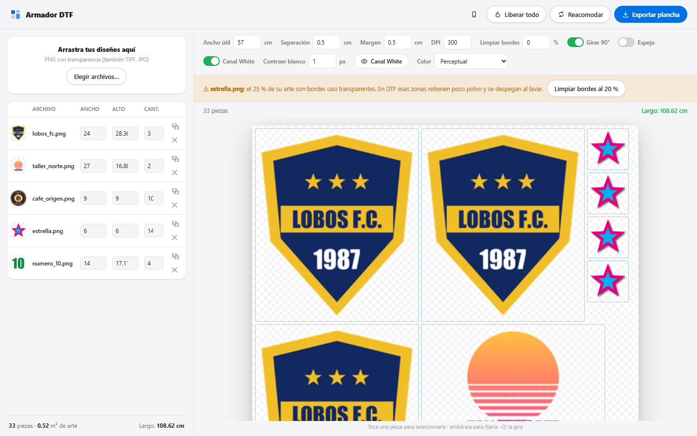
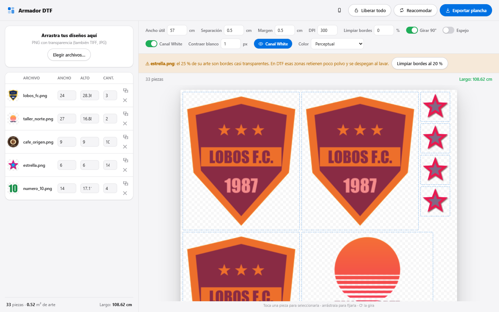
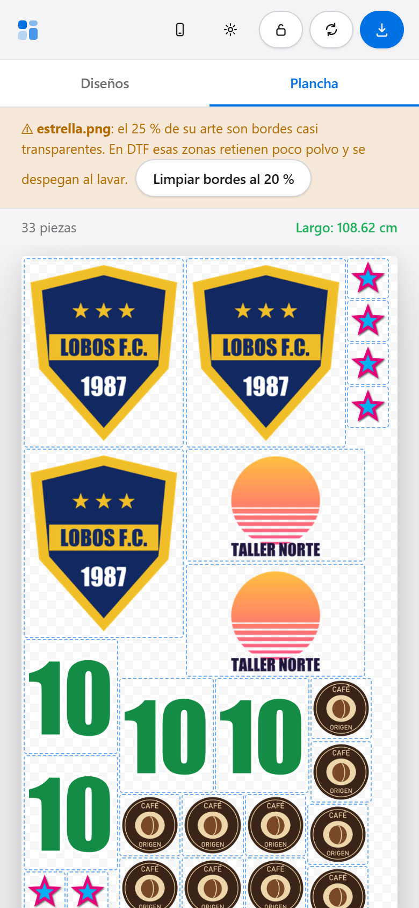
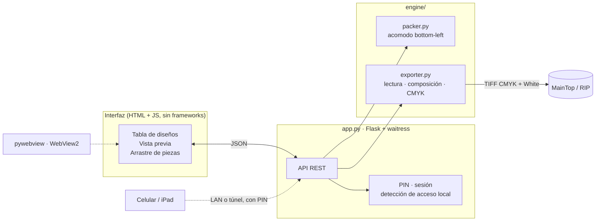

# Armador DTF

**Armado automático de planchas de producción para impresión DTF (Direct to Film).**
Acomoda los diseños de un pedido en el ancho del rollo, calcula el largo de
película y entrega un TIFF CMYK + White listo para el RIP. Sustituye el armado
manual en Photoshop o iCore.




---

## El problema

En un taller DTF, cada pedido pasa por un paso intermedio que no agrega valor:
**armar la plancha**. Alguien abre los archivos del cliente, los escala a la
medida pedida, los duplica tantas veces como prendas haya y los acomoda a mano
sobre un lienzo del ancho del rollo. Después convierte a CMYK, genera el canal
de tinta blanca y exporta para el RIP.

Ese trabajo manual cuesta en tres frentes:

| Frente | Qué se pierde |
|---|---|
| **Tiempo de operador** | Minutos por pedido en una tarea repetitiva, multiplicados por cada pedido del día. |
| **Película y tinta** | Un acomodo hecho a ojo deja huecos. Cada centímetro de largo es película, tinta blanca y polvo adhesivo. |
| **Errores de producción** | Una pieza de menos, una de más, una medida mal escalada o una base blanca que asoma por el borde: se descubren después de imprimir, prensar y gastar. |

## La solución

Armador DTF convierte ese paso en una tarea de captura de datos: **qué diseño,
a qué medida, cuántas veces**. El resto lo calcula el programa.

1. Se arrastran los archivos del cliente (PNG, TIFF de Photoshop, JPG).
2. Se escribe el ancho o el alto en centímetros y la cantidad de cada uno, en una
   tabla que se recorre con el teclado como una hoja de cálculo.
3. La plancha se acomoda sola, con la vista previa y el largo exacto.
4. **Exportar plancha** genera el TIFF que abre el RIP, con el tamaño físico y
   la resolución correctos.

El operador puede intervenir: arrastrar una pieza para fijarla, girarla o
liberarla, y el acomodo automático rellena alrededor sin perder película.

## Resultados medidos

Cada cifra sale de pruebas sobre el programa, no de estimaciones
(detalle en [docs/FLUJO-DE-COLOR.md](docs/FLUJO-DE-COLOR.md)).

| Indicador | Resultado |
|---|---|
| Película al fijar una pieza a mano | **−28 %** respecto del algoritmo anterior (97.3 → 69.7 cm). Fijar ya no cuesta película. |
| Pedido mixto de 32 piezas | 163 → **153 cm** de rollo |
| Acomodo de 800 piezas | **12 ms** |
| Color frente a Photoshop | Valores CMYK **idénticos** en 9 colores sólidos de prueba (Japan Web Coated, Perceptual + BPC) |
| Memoria al exportar 1 m de plancha | 5.35 GB → **1.26 GB** (3 m: 15.2 → 2.7 GB) |
| Cantidad de piezas | Garantizada por el servidor: ni una de más ni una de menos, aunque haya piezas fijadas inválidas |
| Compatibilidad con el RIP | Verificada en **MainTop DTP 6.1**: tamaño físico y 300 dpi exactos al importar |

## Capacidades

**Producción**
- Acomodo automático *bottom-left fill* con rotación de 90° y piezas fijadas como obstáculos.
- Armado semiautomático: arrastrar para fijar 📌, girar con **R**, liberar una o todas.
- Totales en vivo: piezas, m² de arte y largo de plancha.
- Aviso de **bordes casi transparentes** (sombras difuminadas que en DTF no retienen polvo y se despegan), con corrección de un clic.

**Salida para el RIP**
- TIFF **CMYK + White** de 5 canales, con el blanco declarado como tinta plana (InkSet, InkNames y recursos de Photoshop), o CMYK de 4 canales.
- Conversión **sRGB → Japan Web Coated**, Perceptual + compensación de punto negro, igual a Photoshop. Perfil intercambiable.
- **Contracción del blanco** (*choke*) que no borra la base de los trazos finos.
- Compresión PACKBITS: MainTop 6.1 rechaza el LZW de imagecodecs y el deflate.
- Vista previa del **canal White** sobre la plancha.
- Espejo y limpieza de bordes opcionales.

**Lectura de archivos del cliente**
- TIFF de Photoshop con el **canal extra de base blanca**, CMYK, 16 bits, LZW, mosaicos y BigTIFF: el recorte del arte se conserva.
- Perfiles ICC incrustados, alpha premultiplicado y resoluciones mal declaradas (un TIFF "a 1 dpi" no se convierte en una pieza de 15 metros).

**Operación en el taller**
- Aplicación de escritorio **portable** para Windows: no se instala, no necesita Python.
- Uso desde **celular o iPad** en la misma red, protegido con PIN.
- Publicación opcional en internet con un túnel de Cloudflare.

| Canal White | Celular |
|---|---|
|  |  |

## Arquitectura



- **`engine/packer.py`**: acomodo puro, sin dependencias de imagen. Determinista: lo que se ve en pantalla es lo que se exporta.
- **`engine/exporter.py`**: lectura robusta de archivos de imprenta, composición a resolución final y conversión CMYK por franjas.
- **`app.py`**: servidor local, validación de pedidos, seguridad y ventana de escritorio.
- **`static/`**: interfaz web adaptable a escritorio y móvil.
- **`empaque/`**: construcción del ejecutable portable con PyInstaller.

Detalle de cada módulo, la API y el formato del TIFF en
[docs/ARQUITECTURA.md](docs/ARQUITECTURA.md).

## Inicio rápido

### Usarlo en el taller

Descargar el ZIP de la versión, extraerlo y abrir `Armador DTF.exe`. Windows 10 u
11 de 64 bits. Las planchas quedan en `Escritorio\Planchas DTF`.
Guía completa en el [manual de uso](docs/MANUAL.md).

### Desde el código

Requiere Python 3.10 o superior.

```bash
pip install -r requirements.txt
python app.py
```

Abre la interfaz en el navegador. `python app.py --ventana` la abre como
aplicación de escritorio.

Para igualar el color de Photoshop, copiar el perfil CMYK del taller a
`perfiles/cmyk.icc` (ver [perfiles/LEEME.txt](perfiles/LEEME.txt)). Los perfiles
no se incluyen en el repositorio por su licencia.

### Construir el ejecutable

```bash
pip install pyinstaller
python empaque/construir.py carpeta
```

Deja la versión portable en `dist/Armador DTF/`.

## Calidad

```bash
pip install -r requirements-dev.txt
python -m pytest
```

43 pruebas automáticas cubren los tres módulos y corren en cada *push* con GitHub Actions:

- **Acomodo**: sin solapes, separación respetada, piezas fijadas, rotación, determinismo, aprovechamiento y rendimiento.
- **Exportación**: estructura del TIFF que espera MainTop, compresión, canal White, choke en trazos finos y equivalencia exacta entre la conversión por franjas y la de la plancha completa.
- **Servidor**: PIN, bloqueo por fuerza bruta, acceso por túnel o proxy, rutas fuera de la carpeta de salida, carga de archivos dañados, cantidades absurdas y exportación de punta a punta.

Además, [`tests/e2e/prueba_e2e.py`](tests/e2e/prueba_e2e.py) valida **el ejecutable
tal como se entrega**: se abre el `.exe` recién descomprimido y el script lo
recorre por HTTP como lo haría la interfaz.

## Documentación

| Documento | Contenido |
|---|---|
| [Manual de uso](docs/MANUAL.md) | Operación diaria, ajustes, armado semiautomático, uso desde el celular |
| [Arquitectura](docs/ARQUITECTURA.md) | Módulos, API, algoritmo de acomodo, formato del TIFF, empaquetado |
| [Flujo de color](docs/FLUJO-DE-COLOR.md) | Bitácora técnica de las decisiones de color, con mediciones |
| [Seguridad](docs/SEGURIDAD.md) | Modelo de amenazas del acceso por red e internet |
| [Cambios](CHANGELOG.md) | Historial de versiones |

## Estructura del repositorio

```
├── app.py                  servidor, API y ventana de escritorio
├── engine/
│   ├── packer.py           acomodo de piezas en el rollo
│   └── exporter.py         lectura de diseños y exportación TIFF
├── static/                 interfaz web (escritorio y móvil)
├── perfiles/               perfil CMYK del taller (no versionado)
├── empaque/                construcción del .exe portable
├── tests/                  pruebas automáticas y de punta a punta
└── docs/                   manual, arquitectura, color y seguridad
```

## Hoja de ruta

- Confirmar en la impresora DTF de producción el consumo real de tinta blanca por canal.
- Plantillas de pedido reutilizables (diseño + medida + cantidad).
- Estimación de costo por plancha: película, tinta y polvo por metro.
- Exportación por lotes cuando el pedido supera el largo máximo de un rollo.
- Firma digital del ejecutable para evitar el aviso de SmartScreen.

---

Desarrollado para la operación diaria de un taller de impresión DTF que trabaja
con rollo de 60 cm, MainTop 6.1 y 300 dpi.
