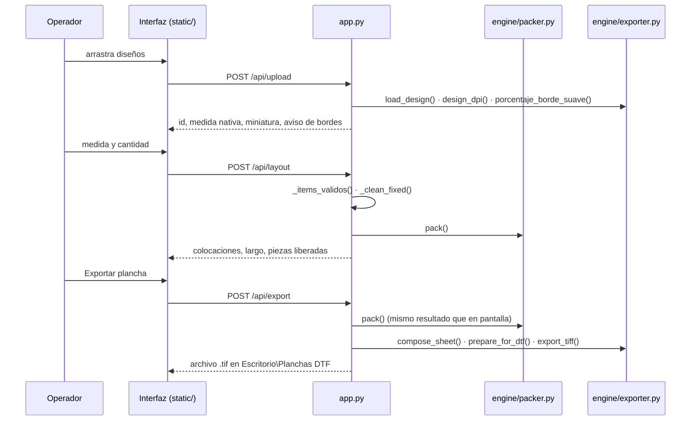
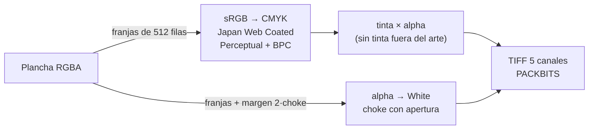

# Arquitectura

El Armador DTF es una aplicación local: un servidor Python sirve la interfaz web
y hace todo el trabajo pesado en la misma PC donde está el RIP. La ventana de
escritorio, el celular y el túnel a internet son solo distintas formas de llegar
a ese servidor.

## Módulos

### `engine/packer.py`: acomodo

Función pura, sin dependencias de imagen: recibe piezas en centímetros y
devuelve posiciones. Que sea **determinista** es una propiedad de diseño: la
exportación vuelve a calcular el acomodo y debe coincidir con la vista previa.

**Algoritmo: bottom-left fill con obstáculos.**

1. Se expanden las cantidades en copias y se ordenan de mayor a menor lado. Las
   grandes primero, para que los huecos chicos queden para las piezas chicas.
2. Las alturas candidatas son el margen superior y el borde inferior (más la
   separación) de cada pieza colocada, en una lista ordenada.
3. Para cada copia se recorren las alturas de arriba abajo. En cada una,
   `_scan_x` busca el primer hueco horizontal donde cabe la pieza en cualquiera
   de sus orientaciones permitidas. La primera altura que tiene hueco gana.
4. Las piezas fijadas por el operador entran como rectángulos ya ocupados.

**Optimización.** Para cada tamaño de pieza se guarda la altura donde se colocó
la última copia (`pisos`). Como solo se agregan piezas, una posición descartada
para ese tamaño no vuelve a servir y la búsqueda siguiente empieza desde ahí.
Si aparece una altura nueva por encima del piso, el piso baja a esa altura.
800 piezas: 40 → 12 ms.

| Caso (rollo de 57 cm) | Estantes (anterior) | Bottom-left |
|---|---|---|
| 12 piezas de 20 × 13.3 cm | 83.5 cm | 69.7 cm |
| las mismas con 1 pieza fijada | 97.3 cm | 69.7 cm |

### `engine/exporter.py`: lectura, composición y salida

**Lectura (`load_design`).** Todo diseño entra como RGBA sRGB.

- Si un TIFF trae más canales de los que corresponden a su espacio de color, se
  lee con `tifffile` y se arma el RGBA a mano (`_tiff_con_canales_extra`). El
  canal extra se toma como transparencia si viene declarado como alpha, si
  Photoshop lo llamó *White/Blanco/Spot/Base* o si se comporta como una máscara
  de cobertura. Pillow descarta ese canal, que en los archivos de imprenta es
  justamente el recorte del arte.
- El alpha premultiplicado se des-premultiplica.
- CMYK se convierte a sRGB con su perfil incrustado o con el del sistema.
- `design_dpi` descarta resoluciones imposibles (fuera de 10–6000 dpi) y usa
  300. Un TIFF con `ResolutionUnit = NONE` se leía a 1 dpi y la pieza medía
  15 metros.

**Composición (`compose_sheet`, `prepare_for_dtf`).** Cada diseño se escala con
Lanczos a su tamaño final (una sola vez por tamaño y orientación) y se compone
sobre una plancha RGBA transparente. Luego se aplican la limpieza de bordes
y el espejo, si están activados.

**Salida (`export_tiff`).**

| Elemento | Valor | Por qué |
|---|---|---|
| Photometric | `SEPARATED` (CMYK) | Lo que espera el flujo calibrado del taller |
| Canales | C, M, Y, K, White | El blanco como 5º canal, sin `ExtraSamples` de alpha |
| Compresión | PACKBITS | MainTop 6.1 no decodifica el LZW de imagecodecs ni deflate |
| `InkSet` / `NumberOfInks` / `InkNames` | CMYK / 5 / `Cyan…White` | Declarar el blanco como tinta plana |
| Tag 34377 | Recursos de Photoshop | El canal aparece como *White* al abrirlo en Photoshop |
| Tag 34675 | Perfil ICC | El RIP sabe en qué CMYK viene el archivo |
| Resolución | dpi del ajuste, en pulgadas | Tamaño físico exacto al importar |

**Por franjas.** La conversión se hace en franjas de 512 filas con una
transformación de color construida una sola vez, y escribe directo en un arreglo
`uint8` preasignado. Convertir la plancha entera en `float32` costaba 5.3 GB por
metro; por franjas, 1.26 GB. El canal White se procesa con un margen de
`2 × choke` filas arriba y abajo porque la apertura morfológica (erosión +
dilatación) mira `choke` filas en cada paso: así el resultado es idéntico al de
la plancha completa.

**Choke que respeta trazos finos (`_contraer_blanco`).** Erosionar el blanco
evita que asome por el borde del color, pero borra por completo la base de
cualquier trazo más delgado que el choke. Se calcula la apertura (erosión
seguida de dilatación): lo que tiene arte pero desaparece en la apertura es
trazo fino, y ahí el blanco se devuelve completo.

**Escritura atómica.** `app._escribir_archivo` escribe en `*.parcial` y
renombra al terminar. Una exportación fallida dejaba antes un `.tif` de 8 bytes
con nombre de plancha válida.

### `app.py`: servidor

Flask, servido por **waitress** en un hilo (`clear_untrusted_proxy_headers=False`
para conservar las cabeceras del túnel, que la detección de acceso local
necesita ver).

**Validación del pedido.** El navegador propone, el servidor decide:

- `_sheet_opts` acota cada ajuste a un rango válido.
- `_items_validos` descarta filas sin diseño o con medidas inválidas, y aplica
  topes de cordura (2000 copias por fila, 500 cm por lado).
- `_clean_fixed` valida cada pieza fijada (que su fila exista, que conserve el
  tamaño, que quepa y no se encime, que no exceda la cantidad). La que no pasa
  vuelve al acomodo automático, así que la plancha lleva siempre la cantidad
  pedida.

**Ciclo de vida.** Al abrir, `main()` comprueba si ya hay un Armador en el
puerto. Si lo hay, muestra ese y termina. Si no, limpia las cargas de la sesión
anterior, busca un puerto libre, arranca el servidor y abre la ventana
(pywebview + WebView2). Sin WebView2 abre el navegador con una ventanita de
tkinter para poder cerrar el programa.

### `static/`: interfaz

HTML, CSS y JavaScript sin frameworks ni paso de compilación. Diseño adaptable:
en el celular la tabla y la plancha se reparten en dos pestañas. Los nombres de
archivo se insertan como texto, nunca como HTML.

## API

Todas las rutas exigen sesión salvo `/login`, `/api/login` y `/api/ping`. En la
propia PC la sesión se abre sola (ver [SEGURIDAD.md](SEGURIDAD.md)).

| Método | Ruta | Uso |
|---|---|---|
| GET | `/api/ping` | Detectar una instancia abierta |
| POST | `/api/login` · `/api/logout` | Sesión por PIN |
| GET | `/api/config` | Carpeta de salida, perfil CMYK, direcciones de red, estado del túnel |
| POST | `/api/upload` | Carga de diseños (multipart) |
| POST | `/api/layout` | Acomodo: `{items, fixed, sheet}` → colocaciones y largo |
| POST | `/api/preview-white` | Máscaras del canal White por diseño y tamaño |
| POST | `/api/export` | Genera la plancha y devuelve la ruta del TIFF |
| GET | `/api/descargar` | Descarga una plancha exportada (desde el celular) |
| POST | `/api/quitar` | Libera un diseño cargado |
| POST | `/api/abrir-carpeta` | Abre la carpeta de salida (solo en la PC) |
| POST | `/api/tunel` | Abre o cierra el túnel de Cloudflare (solo en la PC) |

## Empaquetado

`empaque/construir.py` arma con PyInstaller una carpeta portable (*onedir*, abre
en 1–2 s) o un ejecutable de un solo archivo (*onefile*, ~6 s porque se
descomprime en cada arranque). Se distribuye la carpeta.

Detalles que no son opcionales:

- **`--collect-submodules imagecodecs`.** imagecodecs carga cada codec por
  nombre en tiempo de ejecución y no hay hook de PyInstaller para él. Sin esa
  opción los TIFF con LZW no abren y la exportación falla con
  `could not import name 'packbits_encode'`.
- Se excluyen los codecs que no aparecen en archivos de imprenta (AVIF, JPEG XL,
  HEIF, compresores científicos): 35 de los 50 MB del paquete.
- Los datos del usuario (`config.json`, `uploads/`) se guardan junto al `.exe`,
  no dentro del paquete, y **nunca se incluyen al distribuirlo**: cada PC genera
  su propio PIN.
- La ventana vuelve a cargar si WebView2 descarta la primera navegación (abría
  en blanco hasta pulsar F5).

## Pruebas

| Archivo | Alcance |
|---|---|
| `tests/test_packer.py` | Acomodo: solapes, separación, rotación, fijadas, determinismo, aprovechamiento, rendimiento |
| `tests/test_exporter.py` | Lectura de archivos de imprenta, ajustes DTF, estructura del TIFF, equivalencia de franjas |
| `tests/test_api.py` | Seguridad, validación de pedidos y flujo completo con el cliente de pruebas de Flask |
| `tests/e2e/prueba_e2e.py` | El programa empaquetado, por HTTP, tal como se entrega |
| `tests/muestras.py` | Genera los archivos de prueba, cada uno ligado a un defecto real encontrado en producción |
