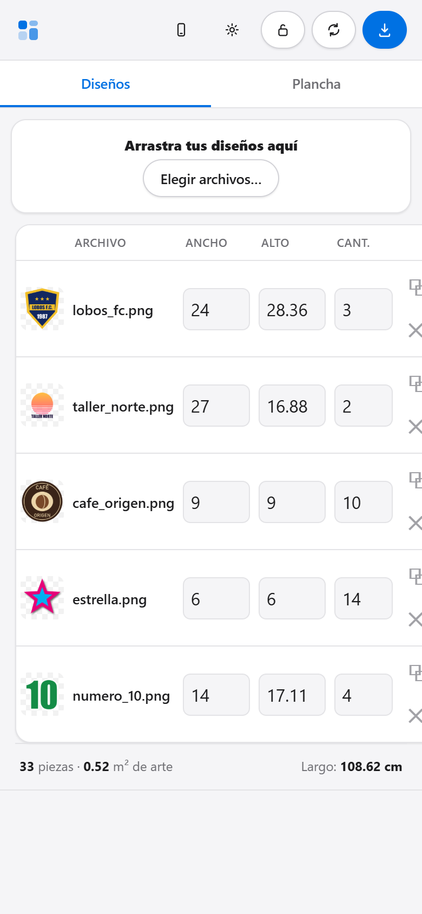

# Manual de uso

Guía de operación diaria del Armador DTF. Para la parte técnica, ver
[ARQUITECTURA.md](ARQUITECTURA.md).

## 1. Abrir el programa

1. Extraer el ZIP **antes** de abrir nada. Abierto desde dentro del ZIP, el
   programa no encuentra sus archivos.
2. Doble clic en **`Armador DTF.exe`**. Se abre en su propia ventana, sin
   navegador, sin Python y sin escribir direcciones.
3. La primera vez Windows muestra *"Windows protegió su PC"*, porque el
   ejecutable no está firmado digitalmente: **Más información → Ejecutar de
   todas formas**.
4. Si aparece el aviso del Firewall de Windows, **solo hay que permitirlo si el
   programa se va a usar desde el celular o el iPad**. Para trabajar en la PC no
   hace falta.

El programa es **portable**: no se instala y no toca el registro de Windows.
Guarda su PIN y sus archivos de trabajo junto al `.exe`. Si la carpeta no
permite escribir (una USB protegida o `Archivos de programa`), usa
`%LOCALAPPDATA%\ArmadorDTF`.

Abrirlo dos veces no levanta un segundo servidor: la segunda ventana muestra el
programa que ya está abierto, sin perder los diseños cargados.

## 2. Armar una plancha

1. **Cargar los diseños.** Arrastrarlos a la zona de carga o usar *Elegir
   archivos…*. Se aceptan PNG con transparencia, TIFF (incluidos los de
   Photoshop con canal de base blanca, CMYK, 16 bits y LZW) y JPG.
2. **Medida.** Escribir el **ancho o el alto en cm** de cada diseño; el otro
   lado se calcula solo, respetando la proporción.
3. **Cantidad.** Cuántas piezas lleva el pedido.
4. **Revisar.** La plancha se acomoda sola. Arriba a la derecha está el largo
   total; abajo, el total de piezas y los m² de arte.
5. **Exportar plancha.** El archivo queda en `Escritorio\Planchas DTF`, con un
   nombre como `plancha_2026-09-30_10-15-00_CMYK+W.tif`.

### La tabla de diseños

- **Enter** baja a la misma columna de la fila siguiente, como en una hoja de
  cálculo.
- **⧉ Duplicar** crea otra fila con el mismo archivo, para un mismo diseño en
  dos tamaños.
- **✕** quita la fila.

## 3. Armado semiautomático

El acomodo es automático, pero el operador puede intervenir:

| Acción | Cómo |
|---|---|
| Fijar una pieza en un lugar | Arrastrarla en la vista previa. Queda marcada con 📌. |
| Girar 90° | Tocar la pieza y pulsar **⟳** o la tecla **R**. Queda fijada. |
| Liberar una pieza | Seleccionarla y pulsar **🔓**. |
| Volver a automático | **Liberar todo**. |

Reglas que aplica el programa:

- El acomodo automático **rellena alrededor** de las piezas fijadas, sin perder
  película por haberlas movido.
- Si una posición pisa otra pieza fijada, se rechaza y se avisa.
- Cambiar el **tamaño** de una fila libera sus piezas fijadas, porque su
  posición ya no sería válida. Cambiar la **cantidad** las conserva.
- Una pieza fijada que deja de ser válida (se achicó el ancho del rollo, quedó
  encimada o se borró su fila) **vuelve sola al acomodo automático**, con aviso.
- **La plancha lleva siempre exactamente la cantidad pedida.**
- La exportación respeta exactamente lo que se ve en pantalla.

## 4. Ajustes

| Ajuste | Qué hace | Valor típico |
|---|---|---|
| Ancho útil | Ancho imprimible del rollo | 57 cm (rollo de 60) |
| Separación | Espacio entre piezas | 0.5 cm |
| Margen | Borde libre alrededor de la plancha | 0.5 cm |
| DPI | Resolución del archivo final | 300 |
| Limpiar bordes | Borra los píxeles por debajo de ese % de opacidad | 0, o 15–20 % |
| Girar 90° | Permite rotar piezas para aprovechar el rollo | activado |
| Espejo | Espejea la película | **apagado** |
| Canal White | TIFF de 5 canales (CMYK + White) o de 4 (CMYK) | activado |
| Contraer blanco | Retira la base blanca del borde del arte | 1 px |
| Color | Propósito de conversión a CMYK | Perceptual |

**Espejo.** En DTF la película se imprime al revés porque el diseño se
transfiere a la prenda. Casi todos los RIP lo hacen por su cuenta. Si MainTop ya
espejea y además se activa aquí, el diseño sale al derecho y se arruina.
Activarlo solo después de comprobar que MainTop *no* lo hace.

**Limpiar bordes.** Los píxeles casi transparentes reciben muy poca tinta,
retienen poco polvo adhesivo y terminan despegándose en el lavado. Al cargar un
diseño el programa mide qué parte de su arte cae en esa franja y, si es alta
(una sombra difuminada puede ser el 45 %), avisa con un botón que sube el ajuste
al 20 % de un clic.

**Contraer blanco.** Retira la base blanca del borde para que no asome fuera del
color. Si MainTop ya contrae el blanco, dejarlo en 0: contraer dos veces deja el
color sin blanco debajo y esa tinta no transfiere. En los trazos finos el blanco
se conserva completo, porque si no se quedarían sin base.

### Canal White

El botón **👁 Canal White** pinta en rojo dónde llevará tinta blanca la plancha,
como Photoshop muestra un canal de tinta plana. Se calcula con el mismo
algoritmo de la exportación, incluido el choke.

## 5. Perfil de color

La conversión a CMYK usa `perfiles/cmyk.icc`. El ejecutable trae **Japan Web
Coated**, la misma configuración de Photoshop del taller (Perceptual +
compensación de punto negro), así que el color sale igual que en ese flujo.

Para usar otro perfil, copiarlo a una carpeta `perfiles` junto al `.exe` con el
nombre `cmyk.icc` y reiniciar el programa. Si no hay ninguno, se usa el SWOP de
Windows, que no está pensado para DTF. El porqué de cada decisión está en
[FLUJO-DE-COLOR.md](FLUJO-DE-COLOR.md).

## 6. Desde el celular o el iPad

El botón **📱** de la barra superior muestra la dirección de la red WiFi y el
**PIN**.

- **En la PC donde corre el programa no se pide PIN.** Sí lo piden el celular,
  el iPad y la dirección de internet.
- El PIN se genera solo la primera vez y se guarda en `config.json`, junto al
  programa. Para fijarlo, editar ese archivo o usar la variable de entorno
  `ARMADOR_PIN`.
- La sesión dura 30 días por dispositivo.
- La plancha se genera y se guarda **siempre en la PC**, que es donde está el
  RIP. Desde el celular se puede armar, revisar, exportar y descargar el archivo.

### Publicarlo en internet

En el mismo botón **📱** está **🌐 Publicar en internet**: abre un túnel de
Cloudflare y da una dirección `https://` que funciona con datos móviles o desde
otra ciudad. Pide confirmación porque, mientras está abierto, cualquiera con el
enlace **y el PIN** puede entrar. Se cierra desde el mismo botón y al cerrar el
programa.

Hace falta `cloudflared.exe` (gratuito, de Cloudflare) en el PATH, instalado o
copiado en la carpeta del programa. La dirección cambia cada vez que se abre el
túnel; una dirección fija requiere un dominio propio en Cloudflare.

## 7. Importar la plancha en MainTop 6.1

- Usar el botón **Import Picture** de la barra de herramientas (el menú
  `Insert > Picture...` no responde en esta versión).
- El diálogo *Import Graph File* muestra el color, la resolución y el tamaño del
  archivo seleccionado: es la forma más rápida de verificar una plancha antes de
  imprimir.
- **MainTop no lee PNG.** Por eso la salida es siempre TIFF.

## 8. Variables de entorno

| Variable | Efecto |
|---|---|
| `ARMADOR_PORT` | Puerto del servidor (8765; si está ocupado, toma el siguiente libre) |
| `ARMADOR_HOST` | `127.0.0.1` para que solo responda en la propia PC |
| `ARMADOR_PIN` | Fija el PIN de acceso por red |
| `ARMADOR_PIN_SIEMPRE` | `1` para pedir el PIN también en la propia PC |
| `ARMADOR_SALIDA` | Carpeta de salida en lugar de `Escritorio\Planchas DTF` |

## 9. Requisitos y consumo

- Windows 10 u 11 de 64 bits, con WebView2 (viene con Windows 11 y con Edge).
  Sin WebView2 el programa se abre en el navegador.
- Memoria al exportar: alrededor de **1 GB por metro de plancha** a 300 dpi.
